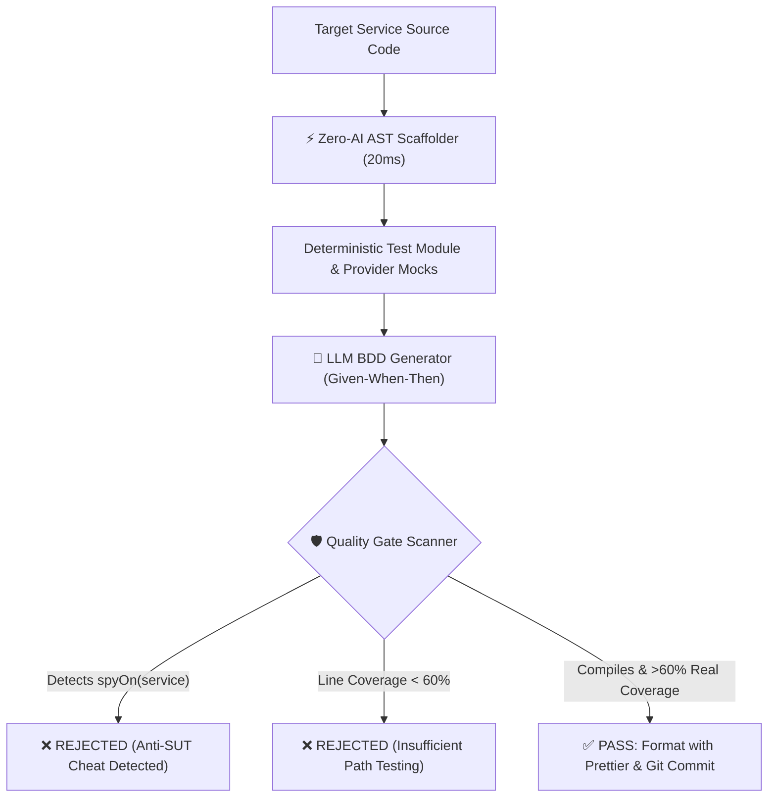

# 🛡️ deep-unit-test

> **Autonomous, high-value unit test engineering for AI coding agents and human craftspeople.**  
> Eliminating the *"Shallow AI Test Trap"* through Vladimir Khorikov's principles, deterministic AST scaffolding, and strict Anti-SUT-mocking quality gates.

[](https://opensource.org/licenses/MIT)
[](https://github.com/redlittlewall/deep-unit-test/pulls)
[](https://www.manning.com/books/unit-testing)

---

## 🛑 The Problem: The "Shallow AI Test Trap"

When developers ask LLMs (Aider, Claude, ChatGPT, Copilot) to generate unit tests, models frequently employ a deceptive shortcut:

```typescript
// ❌ THE CRITICAL AI CHEAT
describe('AdminAiClassifyTattooService', () => {
  it('should reclassify tattoo', async () => {
    // The LLM mocks the very method it is asked to test!
    jest.spyOn(service, 'reclassify').mockResolvedValue(fakeResult);

    const res = await service.reclassify('admin-1', 'tattoo-1');
    expect(res).toBe(fakeResult); 
    // Result: 100% false coverage, 0% real logic tested!
  });
});
```

If a developer deletes the entire business logic inside `reclassify()`, **this test still passes.**  
These are **useless, brittle, and dangerous tests**.

---

## ⚡ The Solution: `deep-unit-test`

`deep-unit-test` enforces a strict architectural standard based on **Vladimir Khorikov's 4 Pillars of a Good Unit Test**:



### Key Pillars:
1. **The Anti-SUT Mocking Law:** The System Under Test (SUT) is NEVER mocked. Only out-of-process collaborators (Repositories, HTTP Clients, Third-party APIs) are mocked.
2. **BDD Given-When-Then:** Every test has clear Arrange-Act-Assert phases.
3. **Zero-AI Determinism:** Boilerplate (`Test.createTestingModule`, type mocks) is extracted deterministically in **20ms** via AST parsers—saving thousands of AI tokens and eliminating syntax hallucinations.
4. **Observable Outcomes:** Tests verify return values, state changes, and collaborator contracts, NOT private internal implementation details.

---

## 📦 Project Layout

```text
deep-unit-test/
├── SKILL.md                 # Antigravity / Claude Code / Copilot Agent Skill
├── README.md                # Documentation and architectural guide
├── rules/
│   ├── anti-cheat.md        # Regex patterns and rules blocking shallow tests
│   ├── khorikov-pillars.md  # Deep dive into Vladimir Khorikov's 4 pillars
│   └── bdd-guidelines.md    # Given-When-Then test structure standard
├── examples/
│   ├── nestjs/              # Golden reference for NestJS / TypeORM / Jest
│   ├── flutter/             # Golden reference for Dart / Flutter / Bloc
│   └── svelte/              # Golden reference for Svelte / TypeScript / Vitest
└── scripts/
    ├── scaffolder.py        # Zero-AI AST mock & module generator
    └── quality_gate.py      # Coverage & anti-cheat validator
```

---

## 🚀 How to Use as an Agent Skill

### In Google Antigravity / Claude Code
Clone or add to your local skills directory:
```bash
git clone https://github.com/redlittlewall/deep-unit-test.git ~/.gemini/antigravity/skills/deep-unit-test
```

### Direct Instruction in Prompts
Add the following rule to your coding agent or system prompt:
> *"Always adhere to the `deep-unit-test` standard: Never mock the SUT (`jest.spyOn(service)` is forbidden). Structure all tests with Given-When-Then. Mock only injected collaborators and enforce $\ge 60\%$ line coverage on real method execution."*

---

## 📚 References & Inspiration
- **Vladimir Khorikov**, *Unit Testing Principles, Practices, and Patterns* (Manning Publications).
- **Martin Fowler**, *Mocks Aren't Stubs*.
- **Kent Beck**, *Test-Driven Development by Example*.

---

## 📄 License
MIT © [Murilo Ferrarezi Chiari (redlittlewall)](https://github.com/redlittlewall)
